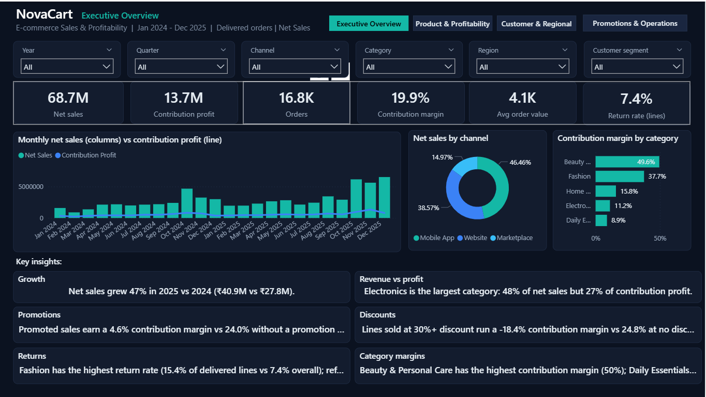
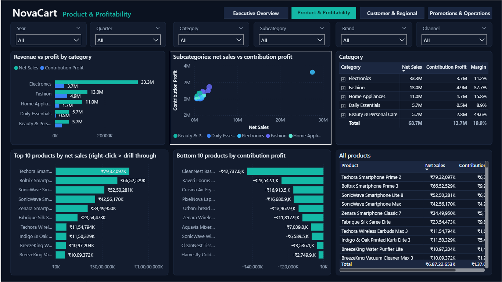
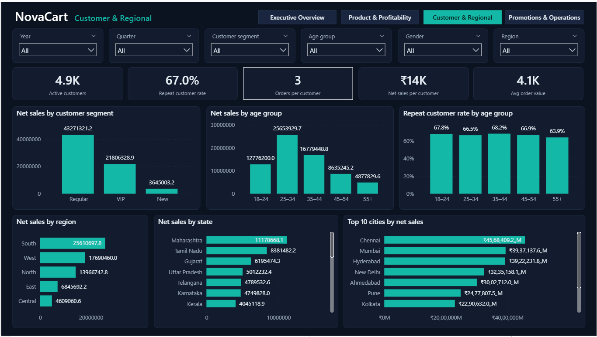
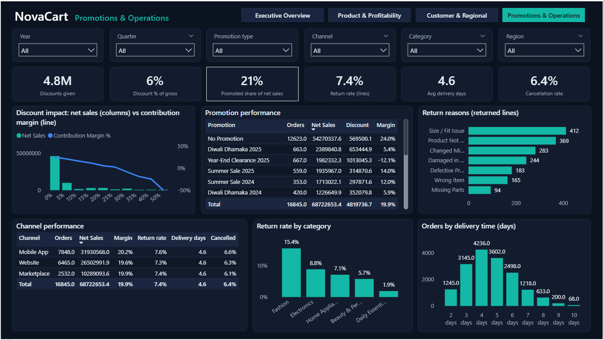
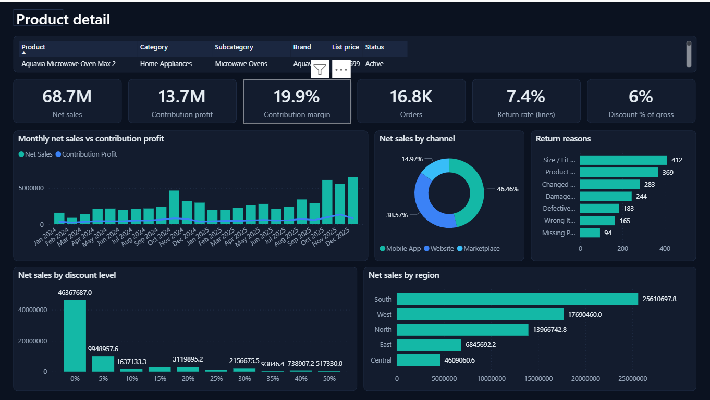

# 📊 NovaCart | E-Commerce Sales & Profitability Analytics

An interactive **E-Commerce Sales & Profitability Analytics Dashboard** developed using Microsoft Power BI to analyse business performance, identify trends, and generate actionable business insights.

<p align="center">
  
</p>

<p align="center">
  <b>Microsoft Power BI | Power Query | DAX | Data Modelling | Excel</b>
</p>

---

## 📌 Project Overview

NovaCart is an end-to-end Business Intelligence project focused on analysing e-commerce sales and profitability over a two-year period, from **January 2024 to December 2025**.

The project transforms transactional data into interactive dashboards that provide insights into overall business performance, product profitability, customer purchasing behaviour, regional sales, promotional effectiveness, and operational performance.

The dashboard is designed to help business stakeholders monitor key performance indicators (KPIs), investigate business trends, and make data-driven decisions.

## 🎯 Business Objectives

- Monitor overall sales, profit, and contribution margin.
- Analyse monthly and yearly business performance.
- Identify high-performing and low-performing products.
- Evaluate product and category profitability.
- Understand customer purchasing patterns and repeat behaviour.
- Compare sales performance across regions and geographical segments.
- Analyse promotional effectiveness and discount impact.
- Investigate product returns, delivery performance, and order cancellations.
- Enable detailed product-level analysis through drill-through functionality.

## 🛠️ Tools & Technologies

| Tool / Technology | Application |
|---|---|
| Microsoft Power BI | Interactive dashboard development |
| Power Query | Data cleaning and transformation |
| DAX | Measures and calculated metrics |
| Data Modelling | Relationships and dimensional modelling |
| Microsoft Excel | Dataset preparation and data handling |

## 📂 Dataset & Data Model

The project covers e-commerce transactions from **January 2024 to December 2025**.

The data model consists of the following fact and dimension tables:

| Table | Description |
|---|---|
| FactSales | Sales transaction records |
| FactReturns | Product return records |
| DimDate | Date and calendar attributes |
| DimProduct | Product information |
| DimCustomer | Customer information |
| DimGeography | Geographical information |
| DimPromotion | Promotion details |
| DimChannel | Sales channel information |

The model enables analysis across multiple business dimensions, including products, customers, geography, promotions, dates, and sales channels.

---

# 📈 Dashboard Pages & Detailed Analysis

## 1. Executive Overview


The Executive Overview provides a consolidated summary of NovaCart's business performance through key metrics and visualisations.

### Key Performance Indicators

| KPI | Value |
|---|---:|
| Net Sales | 68.7M |
| Contribution Profit | 13.7M |
| Orders | 16.8K |
| Contribution Margin | 19.9% |
| Average Order Value | 4.1K |
| Return Rate (Lines) | 7.4% |

### Visual Analysis

- **Monthly Net Sales vs Contribution Profit:** A combined column and line chart compares monthly sales and contribution profit from January 2024 to December 2025.
- **Net Sales by Channel:** A doughnut chart displays the contribution of Mobile App, Website, and Marketplace channels to overall sales.
- **Contribution Margin by Category:** A horizontal bar chart compares profitability across product categories.

### Business Insights

- Net sales increased by **47% in 2025 compared with 2024**, from ₹27.8M to ₹40.9M.
- Electronics contributes approximately 48% of net sales and 27% of contribution profit.
- Beauty & Personal Care records the highest category contribution margin.
- Fashion has a higher return rate than the overall return rate.

### Interactive Filters

Year, Quarter, Channel, Category, Region, and Customer Segment.

---

## 2. Product & Profitability Analysis



This page focuses on evaluating product performance and identifying the contribution of different categories, subcategories, and individual products to business profitability.

### Visual Analysis

- **Revenue vs Profit by Category:** Compares net sales and contribution profit across product categories.
- **Subcategory Sales vs Contribution Profit:** A scatter plot helps identify the relationship between sales and profitability across product subcategories.
- **Category Performance Table:** Provides a detailed comparison of net sales, contribution profit, and contribution margin for each category.
- **Top 10 Products by Net Sales:** Identifies the products generating the highest sales, with drill-through access for further investigation.
- **Bottom 10 Products by Contribution Profit:** Highlights products with the lowest contribution profit, including negative-profit products.
- **All Products Table:** Provides a detailed product-level view of sales and contribution metrics.

### Business Analysis

- Compare product categories based on revenue and profitability.
- Identify products generating high sales but relatively lower contribution margins.
- Investigate products with negative contribution profit.
- Compare product performance across categories and subcategories.
- Identify products requiring further profitability investigation.

### Interactive Filters

Year, Quarter, Category, Subcategory, Brand, and Channel.

---

## 3. Customer & Regional Analysis



This page explores customer purchasing behaviour, repeat purchases, customer segments, and geographical sales distribution.

### Key Performance Indicators

| KPI | Value |
|---|---:|
| Active Customers | 4.9K |
| Repeat Customer Rate | 67.0% |
| Orders per Customer | 3 |
| Net Sales per Customer | ₹14K |
| Average Order Value | 4.1K |

### Visual Analysis

- **Net Sales by Customer Segment:** Compares sales generated by Regular, VIP, and New customer segments.
- **Net Sales by Age Group:** Analyses sales contribution across different customer age groups.
- **Repeat Customer Rate by Age Group:** Compares repeat purchasing behaviour across age segments.
- **Net Sales by Region:** Shows the distribution of sales across South, West, North, East, and Central regions.
- **Net Sales by State:** Ranks states based on their net sales contribution.
- **Top 10 Cities by Net Sales:** Identifies the leading cities contributing to overall sales.

### Business Analysis

- Understand the contribution of different customer segments.
- Identify age groups generating higher sales.
- Compare repeat purchasing behaviour across age groups.
- Identify regions and states with stronger sales performance.
- Recognise cities contributing significantly to overall revenue.
- Explore customer and geographical performance together.

### Interactive Filters

Year, Quarter, Customer Segment, Age Group, Gender, and Region.

---

## 4. Promotions & Operations Analysis



This page evaluates promotional performance and examines the relationship between discounts, profitability, returns, delivery performance, and order cancellations.

### Key Performance Indicators

| KPI | Value |
|---|---:|
| Discounts Given | 4.8M |
| Discount % of Gross | 6% |
| Promoted Share of Net Sales | 21% |
| Return Rate (Lines) | 7.4% |
| Average Delivery Days | 4.6 |
| Cancellation Rate | 6.4% |

### Visual Analysis

- **Discount Impact – Net Sales vs Contribution Margin:** A combined chart analyses how different discount levels relate to sales and contribution margin.
- **Promotion Performance:** A detailed table compares promotions based on orders, net sales, discount amounts, and contribution margins.
- **Return Reasons:** A horizontal bar chart identifies the most frequently recorded reasons for returned products.
- **Channel Performance:** Compares orders, net sales, margin, return rate, delivery days, and cancellation rate across sales channels.
- **Return Rate by Category:** Highlights differences in return rates across product categories.
- **Orders by Delivery Time:** Shows the distribution of orders across delivery durations.

### Business Analysis

- Compare promotional and non-promotional sales performance.
- Evaluate how discount levels affect contribution margins.
- Identify promotions generating lower or negative contribution margins.
- Understand the most common reasons for product returns.
- Compare operational performance across sales channels.
- Identify categories with higher return rates.
- Analyse order distribution by delivery duration.

### Interactive Filters

Year, Quarter, Promotion Type, Channel, Category, and Region.

---

## 5. Product Detail – Drill-Through Analysis



The Product Detail page provides a focused view of an individual product using Power BI drill-through functionality.

Users can navigate from product-level analysis in the Product & Profitability page to this detailed report for further investigation.

### Product Information

The selected product information includes:

- Product name
- Category
- Subcategory
- Brand
- List price
- Product status

### Key Performance Indicators

The page displays the selected product's analytical context through:

- Net Sales
- Contribution Profit
- Contribution Margin
- Orders
- Return Rate
- Discount Percentage

### Visual Analysis

- **Monthly Net Sales vs Contribution Profit:** Tracks the monthly sales and profitability trend.
- **Net Sales by Channel:** Shows the contribution of different sales channels.
- **Return Reasons:** Displays the reasons associated with returned product lines.
- **Net Sales by Discount Level:** Compares sales performance across discount percentages.
- **Net Sales by Region:** Shows the geographical distribution of product sales.

### Business Value

- Investigate individual product performance.
- Understand product profitability across time.
- Compare product sales across channels and regions.
- Examine the relationship between discounts and product sales.
- Explore product-specific return patterns.

---

## 🔍 Key Analytical Capabilities

- Interactive dashboard navigation and slicers.
- Dynamic KPI calculations using DAX.
- Monthly and yearly trend analysis.
- Sales and profitability comparisons.
- Product and category performance analysis.
- Customer segmentation and repeat purchase analysis.
- Regional and geographical sales analysis.
- Promotion and discount impact analysis.
- Returns and operational performance monitoring.
- Drill-through navigation for detailed product investigation.

## 💡 Business Value & Applications

The NovaCart dashboard demonstrates how business intelligence can support e-commerce decision-making.

It helps stakeholders:

- Monitor business performance through consolidated KPIs.
- Identify profitable and underperforming products.
- Understand customer purchasing behaviour.
- Explore geographical sales opportunities.
- Evaluate promotional effectiveness.
- Investigate product returns and operational performance.
- Make informed decisions using interactive analytical reports.

## 📁 Repository Structure

```text
NovaCart-PowerBI-Analytics/
│
├── Screenshots/
│   ├── 01_executive_overview.png
│   ├── 02_product_profitability.png
│   ├── 03_customer_regional.png
│   ├── 04_promotions_operations.png
│   └── 05_product_detail_drillthrough.png
│
├── Dataset/
│
├── PowerBI/
│
├── Documentation/
│
└── README.md
```

## 🚀 How to Explore the Project

1. Clone or download this repository.
2. Locate the Power BI Project (`.pbip`) file.
3. Open the project using Microsoft Power BI Desktop.
4. Ensure that the required dataset is available.
5. Update data source paths if necessary.
6. Refresh the data and explore the interactive report pages.

> **Note:** Microsoft Power BI Desktop is required to open and interact with the report. The data source paths may need to be updated when opening the project on another computer.

---

## 👩‍💻 About the Author

**Ramya Udayakumar**

Aspiring Data Analyst | Power BI | Python | Power Platform

Interested in transforming raw data into meaningful insights and building practical business intelligence solutions.

- **GitHub:** [ramyauday-12](https://github.com/ramyauday-12)
- **LinkedIn:** [ramyau2823](https://www.linkedin.com/in/ramyau2823/)
- **Portfolio:** [View My Portfolio](https://ramyauday-12.github.io/ramya-portfolio/)

---

<p align="center">
  <b>NovaCart | Turning E-Commerce Data into Business Insights</b>
</p>
